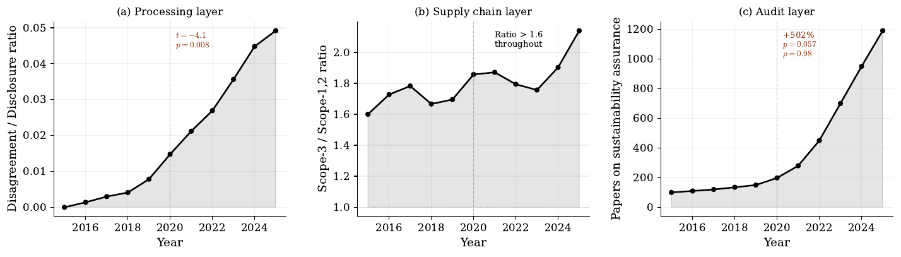
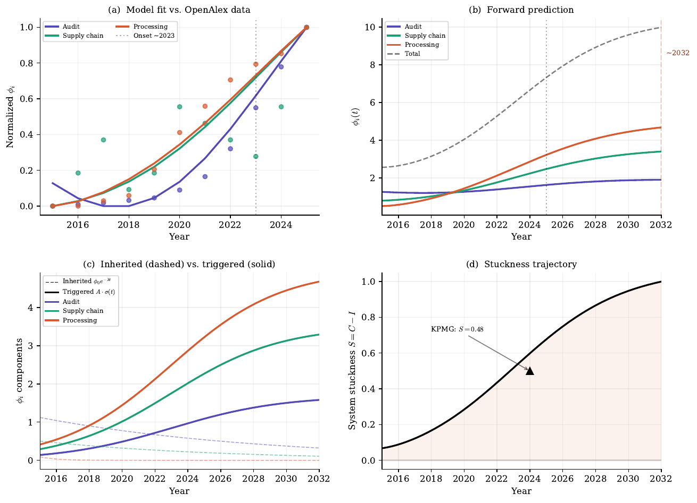

# The Regulatory Waterbed

### Why mandatory disclosure can move information asymmetry instead of removing it

**A working paper by Hakvin Vosteen · 2026**

[**Read the preprint on SSRN →**](https://papers.ssrn.com/sol3/papers.cfm?abstract_id=6415318) &nbsp; · &nbsp; [Download the paper](paper/waterbed_v2.pdf) &nbsp; · &nbsp; [Explore the code](src/)

## The idea

A disclosure rule can improve the information available at the point of reporting while leaving new or existing gaps elsewhere. A company may report more, for example, while investors still face the work of interpreting the report, auditors face verification challenges, and supply-chain data remains difficult to obtain.

The paper calls this the **Asymmetry Migration Principle**. It models information asymmetry across connected institutions using a graph-Laplacian framework and examines three channels: **processing, supply chains, and audit**. The CSRD provides the case study.

## What the paper reports

### Three channels in the research record



*Figure 1 from the preprint. OpenAlex query reported as of 14 March 2026; 2015–2025 series.*

The paper reports that the ratio of research on ESG rating disagreement to ESG disclosure rose from a pre-2020 mean of **0.001** to a post-2020 mean of **0.028** (Welch t = −4.1, p = 0.008). The Scope-3 to Scope-1/2 research ratio remained above **1.6** throughout the series. Research on sustainability assurance increased from **198 papers in 2020 to 1,191 in 2025** (+502%); its pre/post Welch test is reported as p = 0.057.

These are measures of **research attention**, used as proxies in the paper. They do not directly measure information asymmetry or establish that the CSRD caused the changes.

### Different model timescales



*Figure 5 from the preprint. Curves are model outputs and projections, not observed future outcomes.*

The paper's calibration reports the following **model-implied** relaxation times:

| Channel | Effective rate | Approximate relaxation time |
|---|---:|---:|
| Processing | 1.00 per year | 1.0 year |
| Supply chain | 0.09 per year | 11.1 years |
| Audit | 0.07 per year | 13.6 years |

These estimates are outputs of the fitted model, not direct measurements of how long institutions take to adapt. The paper reports a weaker fit for the supply-chain series (R² = 0.34) than for processing (0.97) and audit (0.96).

### A prediction that did not hold as first stated

The original timing hypothesis expected the channels to emerge in a particular sequence. The paper's arrival-time analysis instead found supply-chain research already elevated before the CSRD, followed by processing and then audit indicators. It treats this as a **partial falsification** and proposes a distinction between inherited asymmetry and problems emerging alongside regulatory change. The timing evidence alone does not establish causation.

### Disclosure and assurance

The paper reports a 2024 KPMG readiness comparison of **77% reporting publicly** and **29% audit-ready**. Its constructed gap is 0.48, compared with 0.36 under the paper's earlier baseline. The resulting **33% increase is a change in the paper's constructed indicator**; it is not a direct measurement of overall institutional “stuckness.” The underlying survey values and baseline assumptions are documented in [`data/kpmg_survey.json`](data/kpmg_survey.json).

## Repository guide

| Path | Contents |
|---|---|
| [`paper/`](paper/) | PDF and LaTeX source |
| [`figures/`](figures/) | Five figures from the paper, as PDFs |
| [`assets/`](assets/) | README previews of Figures 1 and 5 |
| [`src/`](src/) | OpenAlex query, figures, calibration, arrival-time and statistics scripts |
| [`data/kpmg_survey.json`](data/kpmg_survey.json) | Manually entered survey values and model inputs |

## Run the analysis

```sh
git clone https://github.com/hakvinv/asymmetry-migration.git
cd asymmetry-migration
python -m venv .venv
source .venv/bin/activate
pip install -r requirements.txt

# Optional: fetch current OpenAlex counts (network required)
python src/01_openalex_query.py

# Figures and analyses
python src/02_figures.py
python src/03_calibration.py
python src/04_arrival_times.py
python src/05_statistics.py
```

The original OpenAlex response is not included in the repository. A fresh query retrieves current counts and may differ from the March 2026 figures. `02_figures.py` reads the downloaded JSON when present and otherwise uses embedded values; the calibration, arrival-time, and statistics scripts use their own embedded series rather than that JSON. The paper's reported numbers have not been independently reproduced in this README revision.

To compile the paper, run `pdflatex waterbed_v2.tex` twice from `paper/` with a suitable LaTeX installation.

## Citation

```bibtex
@misc{vosteen2026waterbed,
  author = {Vosteen, Hakvin},
  title  = {The Regulatory Waterbed: Why Mandatory Disclosure Moves Information Asymmetry Instead of Removing It},
  year   = {2026},
  doi    = {10.2139/ssrn.6415318},
  url    = {https://papers.ssrn.com/sol3/papers.cfm?abstract_id=6415318},
  note   = {SSRN preprint}
}
```

Code is available under the [MIT License](LICENSE).
